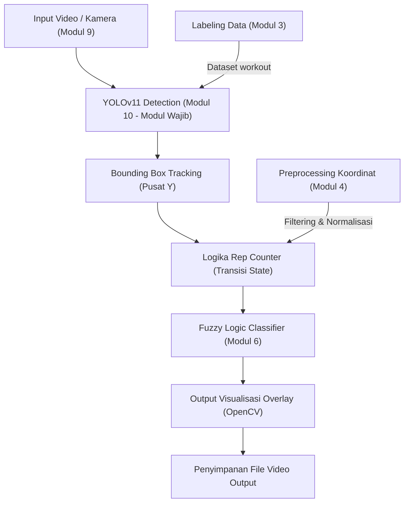

# Product Requirements Document (PRD)
# Sistem Deteksi Gerakan Workout & Penghitung Repetisi Berbasis YOLO

> **Mata Kuliah:** Kecerdasan Buatan (AI)  
> **Jenis Tugas:** Ujian Akhir Semester (UAS)  
> **Tanggal:** 9 November 2026  
> **Workspace:** `GERAKAN WORKOUT/`

---

## Batasan Implementasi Kode (Wajib Diperhatikan)

> **Prinsip Utama:** Seluruh implementasi kode program harus tetap berpedoman pada materi serta modul praktikum yang telah diajarkan. Kode program boleh dikembangkan seperlunya untuk memenuhi studi kasus, namun dilarang menggunakan teknik atau library kompleks di luar materi perkuliahan.

### Hal yang Diperbolehkan
| Aspek | Ketentuan |
|---|---|
| Library | Hanya library praktikum: `ultralytics`, `cv2`, `numpy`, `skfuzzy`, `sklearn`, `re`, `kanren` |
| Paradigma Kode | Prosedural sederhana (while loop, for loop, if-else, function helper) sesuai `YOLO.py` dan `ReadDisplayVideo.py` |
| Fungsi Helper | Penggunaan fungsi `def` sederhana untuk modularisasi kode |
| Komentar | Penjelasan dalam Bahasa Indonesia yang informatif |
| Model YOLO | Prosedur inferensi standar: `YOLO("model.pt")`, `model(frame)`, `result.boxes` |
| OpenCV | Operasi standar: `VideoCapture`, `imshow`, `rectangle`, `putText`, `VideoWriter`, `waitKey` |
| Fuzzy Logic | Operasi standar: `ctrl.Antecedent`, `ctrl.Consequent`, `ctrl.Rule`, `ctrl.ControlSystem` sesuai `FUZZY.py` |

### Hal yang Dilarang
| Aspek | Larangan |
|---|---|
| Library Baru | Tidak menggunakan library yang belum diajarkan seperti `mediapipe`, `tensorflow`, `keras`, `streamlit`, `flask` |
| OOP Kompleks | Tidak menggunakan class inheritance atau abstraksi rumit |
| Multithreading | Tidak menggunakan `asyncio`, `threading`, atau `multiprocessing` |
| GUI Framework | Tidak menggunakan framework GUI eksternal (`tkinter`, `PyQt`, `kivy`), cukup jendela visual OpenCV |
| Database | Tidak menggunakan database eksternal |

### Pedoman Gaya Penulisan Kode
- Kode ditulis secara prosedural dan berurutan dari atas ke bawah.
- Penamaan variabel jelas dan representatif (misal: `rep_count`, `state`, `prev_y`, `confidence`).
- Menyediakan dokumentasi komentar pada blok logika penting.
- Kode diorganisasikan ke dalam file `.py` mandiri yang mudah dieksekusi langsung.

---

## 1. Ringkasan Eksekutif

Sistem ini merupakan aplikasi computer vision berbasis **YOLOv11** yang dirancang untuk:
1. Mendeteksi objek dan subjek workout secara real-time dari video file atau kamera (webcam/eksternal).
2. Menghitung repetisi gerakan workout secara otomatis melalui pelacakan perubahan posisi vertikal bounding box.
3. Mengintegrasikan seluruh modul praktikum AI sebagai penunjang logika, preprocessing, dan analisis intensitas berbasis logika fuzzy.

Seluruh arsitektur sistem dibangun di atas basis kode praktikum, dengan YOLOv11 sebagai komponen inti deteksi.

---

## 2. Latar Belakang & Dataset

Dataset yang digunakan adalah `workout.v12i.yolov11` yang memuat rekaman berbagai variasi latihan fisik:

| Gerakan | Contoh File Anotasi |
|---|---|
| Push-up | `pushup-20-*.jpg` |
| Pull-up | `pull-up_9-*.jpg` |
| Squat | `squat_*.jpg` |
| Leg Extension | `leg-extension_*.jpg` |
| Shoulder Press | `shoulder_press_*.jpg` |
| Chest Fly Machine | `chest_fly_machine_*.jpg` |
| Incline Bench Press | `incline_bench_press_*.jpg` |
| T-Bar Row | `t-bar-row_*.jpg` |
| Tricep Dips | `tricep-dips_*.jpg` |
| Tricep Pushdown | `tricep_pushdown_*.jpg` |

Dataset telah dianotasi dengan label kelas tunggal: `workout` (lisensi CC BY 4.0, Roboflow).

---

## 3. Tujuan Proyek

### 3.1 Tujuan Utama
- Membangun pipeline deteksi gerakan workout dengan model YOLOv11.
- Menghitung repetisi gerakan secara otomatis menggunakan state transition tracking (gerakan naik/turun).
- Menampilkan visualisasi anotasi bounding box, nilai confidence, counter repetisi, dan status intensitas pada layar video.

### 3.2 Capaian Akademik
- Mengintegrasikan sedikitnya 4 modul praktikum ke dalam satu proyek akhir.
- Mendemonstrasikan pemahaman siklus AI: manajemen dataset, preprocessing, training/inferensi model, serta evaluasi sistem inferensi fuzzy.

---

## 4. Arsitektur Sistem



---

## 5. Integrasi Modul Praktikum

### 5.1 Modul Wajib: YOLOv11 (Modul 10)
- **File Referensi:** `YOLO.py`
- **Peran:** Mendeteksi subjek workout per frame serta mengembalikan koordinat bounding box dan tingkat kepercayaan (confidence score).
- **Penyesuaian:** Target kelas disesuaikan untuk gerakan workout, mendukung fallback model bawaan (yolo11n/s/m/l/x) maupun model custom hasil training.

### 5.2 Modul Pendukung 1: Pengolahan Citra & Video (Modul 9)
- **File Referensi:** `ReadDisplayVideo.py` dan `ReadImageData.py`
- **Peran:** Membaca aliran video dari file maupun perangkat kamera, memproses frame per frame, menambahkan text overlay, serta menulis video hasil keluaran.

### 5.3 Modul Pendukung 2: Labeling Data (Modul 3)
- **File Referensi:** `Labelling Data.ipynb`
- **Peran:** Memahami struktur anotasi YOLO `.txt`, verifikasi pembagian data (train, validation, test), serta pemetaan file `data.yaml`.

### 5.4 Modul Pendukung 3: Fuzzy Logic (Modul 6)
- **File Referensi:** `Modul_6_Fuzzy_Logic.ipynb` dan `FUZZY.py`
- **Peran:** Mengklasifikasikan intensitas latihan berdasarkan total repetisi dan kecepatan rata-rata repetisi ke dalam kategori: Ringan, Sedang, atau Berat.
- **Variabel Fuzzy:**
  - Input: `jumlah_rep` (semesta 0-30 rep)
  - Input: `kecepatan` (semesta 0-10 detik/rep)
  - Output: `intensitas` (skala 0-100)

### 5.5 Modul Pendukung 4: Preprocessing Data (Modul 4)
- **File Referensi:** `Preprocessing_Data.ipynb`
- **Peran:** Normalisasi nilai piksel bounding box serta ambang batas pergeseran posisi (threshold filtering) untuk meredam noise deteksi.

### 5.6 Modul Tambahan: NLP & Logic Programming (Modul 7 & Modul 1)
- **File Referensi:** `Modul_7_NLP.ipynb` dan `LogicProgramming.py`
- **Peran:** Parsing input berbasis teks (eksplorasi lanjutan) serta inferensi rule-based logis penentu batas repetisi aman.

---

## 6. Spesifikasi Fitur

### 6.1 Fitur Utama
| ID | Fitur | Keterangan | Modul Terkait |
|---|---|---|---|
| F-01 | Deteksi Gerakan Workout | Deteksi posisi subjek latihan per frame | Modul 10 (YOLO) |
| F-02 | Visualisasi Bounding Box | Overlay kotak deteksi beserta persentase confidence | Modul 10 + Modul 9 |
| F-03 | Penghitung Repetisi | Penghitungan rep otomatis berbasis perubahan posisi vertikal | Modul 10 |
| F-04 | Fleksibilitas Sumber Video | Menu input untuk memilih file MP4, webcam, atau kamera eksternal | Modul 9 |
| F-05 | Pilihan Model Fleksibel | Menu pemilihan model (custom best.pt atau varian pretrained) | Modul 10 |
| F-06 | Deteksi Perangkat Otomatis | Pengenalan otomatis CUDA (NVIDIA) atau fallback ke CPU (AMD/Intel) | Modul 10 |
| F-07 | Display Real-Time | Informasi repetisi, status gerakan, dan intensitas pada layar | Modul 9 |
| F-08 | Penyimpanan Video | Perekaman frame hasil deteksi ke format file MP4 | Modul 9 |

### 6.2 Fitur Analisis
| ID | Fitur | Keterangan | Modul Terkait |
|---|---|---|---|
| F-09 | Estimasi Intensitas | Klasifikasi intensitas berbasis logika fuzzy | Modul 6 (Fuzzy) |
| F-10 | Ringkasan Sesi | Rekap total waktu, repetisi, dan rata-rata kecepatan latihan | Modul 4 |

---

## 7. Panduan Pemilihan Model YOLO

Menu terminal `workout_detector.py` menyediakan opsi pemilihan model:
- `1`: Model custom `best.pt` (hasil fine-tuning dataset workout)
- `2`: `yolo11n.pt` (Nano - ukuran paling kecil, eksekusi paling cepat pada CPU)
- `3`: `yolo11s.pt` (Small - ringan dan efisien)
- `4`: `yolo11m.pt` (Medium - seimbang, standar praktikum)
- `5`: `yolo11l.pt` (Large - akurasi tinggi, kebutuhan komputasi lebih besar)
- `6`: `yolo11x.pt` (Extra Large - akurasi maksimal)

### Rekomendasi Berdasarkan Spesifikasi Perangkat
| Perangkat | Pilihan Rekomendasi | Keterangan |
|---|---|---|
| AMD Ryzen 5 6600H (iGPU Radeon 660M / CPU mode) | `yolo11n.pt` atau `yolo11s.pt` | Memaksimalkan FPS pada pemrosesan CPU |
| Laptop dengan GPU NVIDIA (dukungan CUDA) | Model custom `best.pt` atau `yolo11m.pt` | Paling optimal untuk akurasi dataset workout |
| Pengguna umum repository GitHub | `yolo11n.pt` atau `yolo11m.pt` | Dapat berjalan langsung tanpa file training lokal |

---

## 8. Alur Logika Perhitungan Repetisi

1. Tentukan titik tengah vertikal bounding box:
   `center_y = (y1 + y2) // 2`
2. Bandingkan `center_y` dengan posisi frame sebelumnya (`prev_y`):
   - Jika `center_y < prev_y - THRESHOLD`: arah gerakan naik (`ATAS`).
   - Jika `center_y > prev_y + THRESHOLD`: arah gerakan turun (`BAWAH`).
3. Siklus repetisi: Satu repetisi bertambah saat transisi dari keadaan `BAWAH` kembali menuju `ATAS`.
4. Evaluasi fuzzy berkala: Setiap kelipatan 5 repetisi, sistem menghitung durasi rata-rata per rep dan memperbarui klasifikasi intensitas.

---

## 9. Struktur Berkas Proyek

```
GERAKAN WORKOUT/
│
├── workout_detector.py         <- File program tunggal (Deteksi, Rep Counter, Fuzzy, & Training)
├── requirements.txt            <- Daftar dependensi instalasi
├── README.md                   <- Panduan teknis eksekusi
├── PRD_UAS_WorkoutDetection.md <- Dokumen persyaratan produk (PRD)
│
├── workout.v12i.yolov11/       <- Dataset workout berformat YOLO
│   ├── data.yaml
│   ├── train/
│   ├── valid/
│   └── test/
│
├── YOLO.py                      <- Berkas acuan praktikum modul YOLO
├── ReadDisplayVideo.py          <- Berkas acuan praktikum modul video
├── ReadImageData.py             <- Berkas acuan praktikum modul citra
└── Modul_6_Fuzzy_Logic.ipynb    <- Berkas acuan praktikum modul fuzzy
```

---

## 10. Tahapan Eksekusi

### Tahap 1: Persiapan Lingkungan
1. Jalankan instalasi dependensi melalui terminal:
   `pip install -r requirements.txt`
2. Pastikan ketersediaan dataset pada folder `workout.v12i.yolov11`.

### Tahap 2: Training Model (Opsional)
1. Jalankan `python train_model.py`.
2. Tunggu proses epoch selesai sampai dihasilkan bobot terbaik pada `runs/detect/workout_detector/weights/best.pt`.
3. *Catatan:* Jika pelatihan di CPU memerlukan waktu yang panjang, pengguna dapat langsung menggunakan varian model pretrained pada tahap inferensi.

### Tahap 3: Uji Coba Modul Fuzzy
1. Jalankan verifikasi terpisah: `python fuzzy_intensity.py`.
2. Pastikan simulasi sistem fuzzy mengembalikan nilai defuzzifikasi dan label intensitas yang sesuai.

### Tahap 4: Menjalankan Program Utama
1. Jalankan: `python workout_detector.py`.
2. Pilih nomor model YOLO sesuai kebutuhan perangkat.
3. Pilih sumber input video (file MP4, webcam bawaan, atau kamera eksternal).
4. Amati overlay deteksi, penghitung repetisi, dan penanda intensitas.
5. Tekan tombol `q` untuk mengakhiri sesi.
6. Periksa berkas rekaman keluaran `output_workout.mp4`.

---

## 11. Kriteria Keberhasilan

| Kriteria | Indikator Keberhasilan | Metode Pengukuran |
|---|---|---|
| Deteksi Objek | Bounding box konsisten mengikuti subjek latihan | Visual check pada frame video |
| Akurasi Counter | Galat perhitungan repetisi di bawah toleransi 2 rep per set | Perbandingan hasil otomatis dengan hitungan manual |
| Sistem Fuzzy | Menghasilkan label intensitas (Ringan/Sedang/Berat) | Tinjauan log terminal dan display visual |
| Output Video | Berkas video keluaran tersimpan utuh dan dapat diputar | Verifikasi playback `output_workout.mp4` |
| Kesesuaian Materi | Bebas dari pustaka baru di luar materi praktikum | Audit dependensi berkas program |
